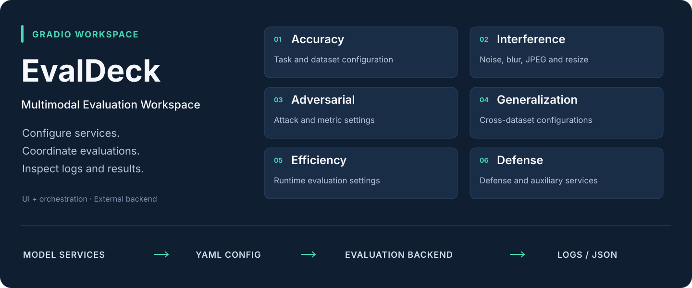
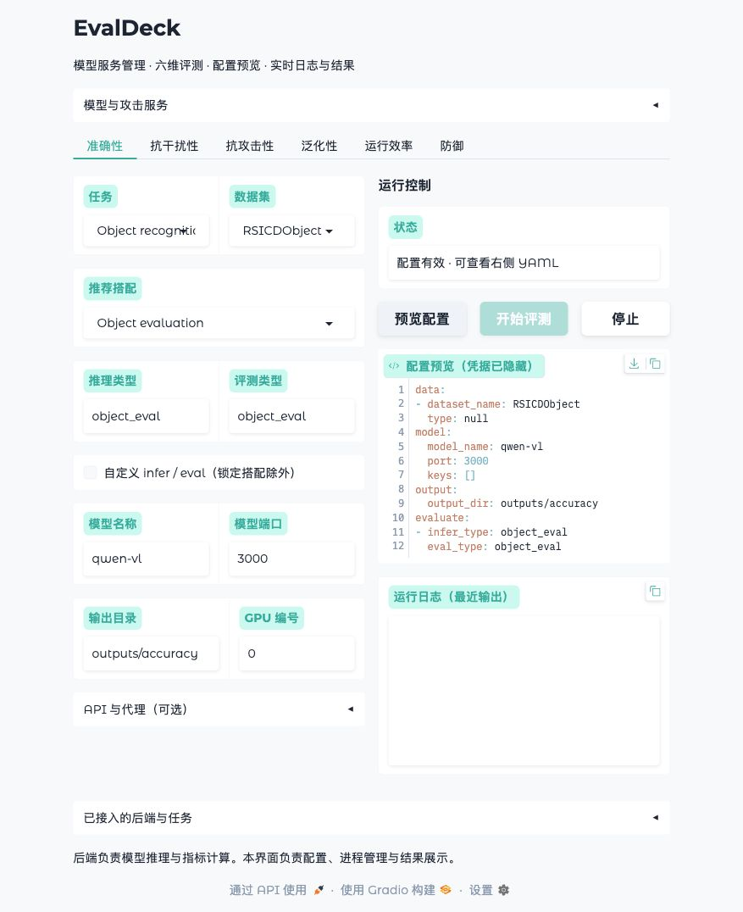
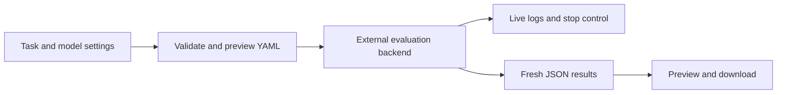

<div align="center">

# EvalDeck

**Multimodal Evaluation Workspace**

Model services and six evaluation dimensions, in one place.

[](#quick-start)
[](https://github.com/gradio-app/gradio)
[](LICENSE)

English · [简体中文](README.zh-CN.md)

</div>

Configure model services, prepare evaluation requests, stream backend output, and inspect results from a Gradio workspace. Originally developed in 2025, the project now separates configuration, UI, execution, and result handling into focused modules.

This repository contains the **interface and orchestration layer**. Connect your own evaluation backend, model weights, datasets, and attack implementations.



## Six evaluation dimensions

| Dimension | What you configure |
| --- | --- |
| **Accuracy** | Task, dataset, inference/evaluation scheme, and model endpoint |
| **Interference robustness** | Salt noise, Gaussian noise, motion blur, JPEG compression, and resizing |
| **Adversarial robustness** | Attack selection and dataset-specific metric/parameter settings |
| **Generalization** | Two datasets and their corresponding inference/evaluation settings |
| **Efficiency** | Dataset and model settings for an external efficiency evaluation |
| **Defense** | Attack/defense parameters and auxiliary model endpoints |

Metrics and transformations are implemented by the connected backend.

## What is included

- **Tabbed workspace** with shared controls across all six evaluation modes.
- **YAML deployment configuration:** register services, supported task combinations, backend commands, and result patterns without editing Python.
- **Configuration preview** with masked credentials and validation before execution.
- **Managed processes:** GPU selection, streaming output, stop controls, and automatic temporary-file cleanup.
- **Results in every panel:** JSON inspection, bounded large-file previews, and full-file downloads. Old results are never presented as a new run.
- **Regression checks:** real subprocess fixtures cover the YAML contracts and execution lifecycle without requiring models or GPUs.

<details open>
<summary>Interface preview</summary>



The screenshot shows configuration preview with the example task registry; no benchmark result is simulated.

</details>

## Quick start

Use Python 3.10 or newer:

```bash
git clone https://github.com/kaka1215/EvalDeck.git
cd EvalDeck
python -m venv .venv
source .venv/bin/activate
python -m pip install -r requirements.txt
python app.py --config configs/example.yaml
```

Open **http://127.0.0.1:7980**. The example includes an illustrative task registry, so you can fill in a model name and preview YAML immediately. Evaluation buttons become available when backend commands are configured.

```bash
cp configs/example.yaml configs/local.yaml
# Add your service scripts, task registry, and backend commands.
python app.py --config configs/local.yaml --check-config
python app.py --config configs/local.yaml --port 7980
```

See the [backend integration guide](docs/integration.md) for command arguments, path resolution, payload schemas, and result discovery.

## Workflow



## Repository layout

```text
EvalDeck/
├── app.py                  # CLI entry point
├── configs/example.yaml    # Deployment template
├── webui/
│   ├── config.py           # Configuration loading and validation
│   ├── payloads.py         # Six backend YAML contracts
│   ├── processes.py        # Streaming and process lifecycle
│   ├── services.py         # Model and attack launchers
│   ├── evaluation.py       # Shared evaluation pipeline
│   ├── results.py          # Fresh result discovery and previews
│   └── ui.py               # Gradio components and event wiring
├── tests/test_workflow.py   # Payload and subprocess regression tests
├── docs/integration.md     # Backend integration guide
└── requirements.txt
```

The former `test.py` application has been replaced by `app.py` and the `webui` package. The original revision remains available in Git history. Local deployment files and generated outputs are ignored by Git.

## Development

```bash
python -m unittest discover -s tests -v
python app.py --config configs/example.yaml --check-config
```

The application binds to localhost by default. GPU service launchers target Linux and run configured Bash scripts; the UI and Python subprocess tests also run on macOS. See [deployment notes](docs/integration.md#development) before exposing the interface to a network.

## License

[MIT](LICENSE)
